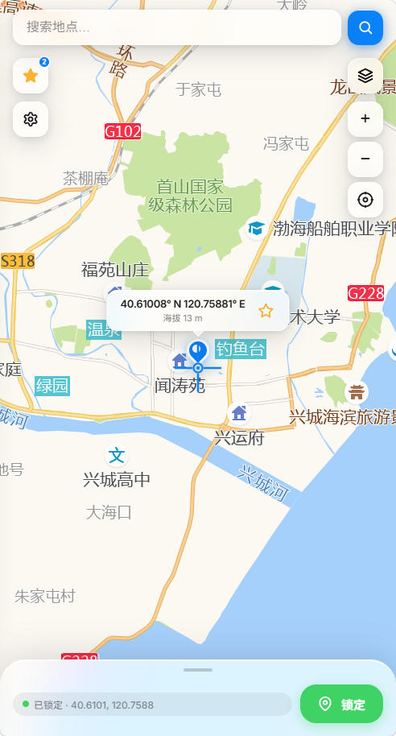
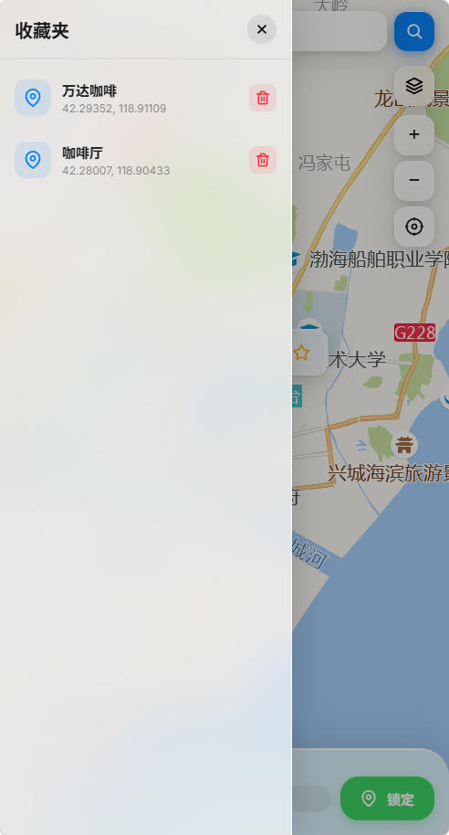
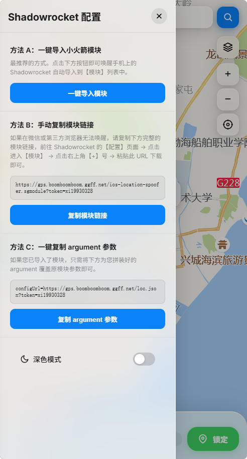
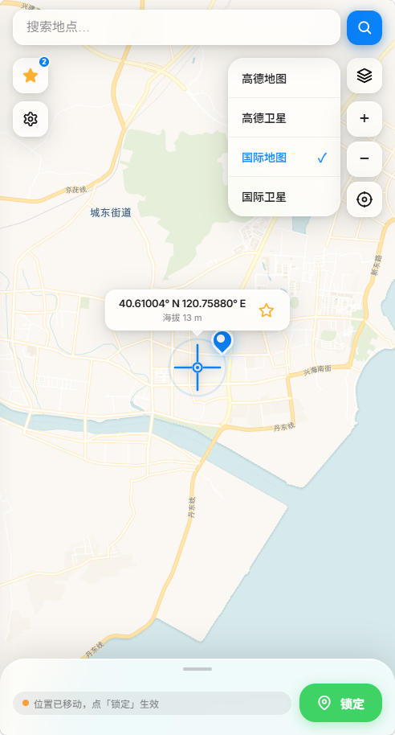
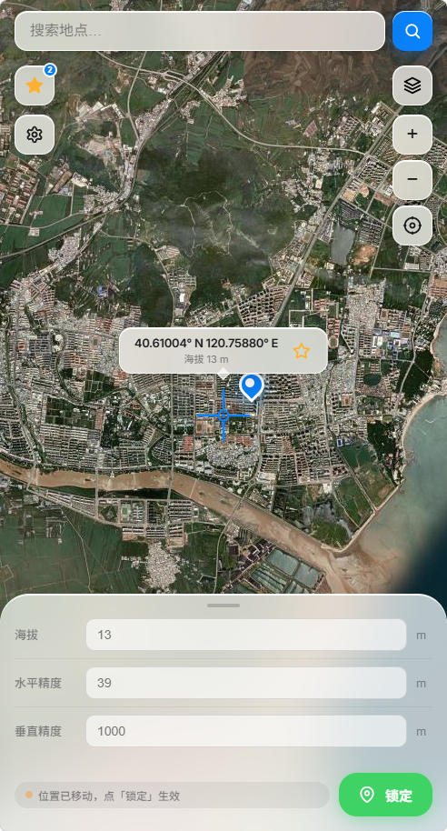
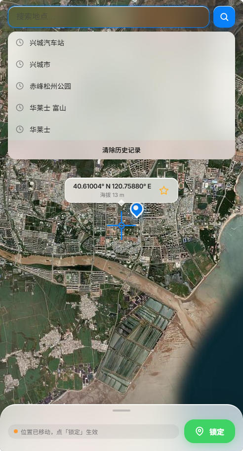

# iOS-Location-Spoofer-Web

[](https://creativecommons.org/licenses/by-nc-sa/4.0/)

> ### ⚠️ 【防骗与严禁倒卖声明】
> 本项目为 **100% 免费开源项目**（唯一官方开源仓库：[akudamatata/iOS-Location-Spoofer-Web](https://github.com/akudamatata/iOS-Location-Spoofer-Web)），本项目遵循 **CC BY-NC-SA 4.0** 开源许可协议。
> **「严禁任何个人或组织以任何形式进行二次售卖、转售、商业收费代搭建、打包牟利等行为」**。
> 若您是通过闲鱼、淘宝、拼多多、付费微信群等任何渠道付费购买获得本项目的，**您已被欺诈，请立即向购买平台申请退款并举报不良商家！**

📱 基于 **Shadowrocket MITM** 方案的 iOS GPS 模拟定位 Web 管理面板。

采用 Apple 2026 **Liquid Glass（液态玻璃）** 视觉美学设计，全屏地图选点，支持 100% 独立离线自建托管。

---

## 🌟 核心特性

| | 特性 | 说明 |
|---|---|---|
| 🗺 | **多地图切换** | CartoDB / Esri 卫星 / 高德地图 / 高德卫星，支持国内外定位 |
| 🎯 | **准星锁定** | 滑动地图对准目标，点击锁定后地图显示蓝色图钉标记已生效坐标 |
| 📍 | **当前位置** | 一键回到当前物理位置并纠偏对齐 |
| 🔒 | **完全自建托管** | 内置 `location-spoofer.js`，无需依赖 GitHub Raw 链接 |
| ⭐ | **智能收藏夹** | 毛玻璃面板，保存常用地点；已收藏位置星标实心，点击实心星直接取消收藏；相同坐标自动去重 |
| 🔢 | **高级参数** | 可调节海拔、水平精度、垂直精度（支持地形高度自动获取）|
| 🔍 | **坐标直跳** | 搜索框直接粘贴经纬度（如 `39.9087, 116.3975`）即可跳转，无需调 API |
| 🐞 | **调试日志** | 面板内一键开启 debug，Shadowrocket 日志输出改写详情，便于排查「模块不生效」 |
| 🌙 | **深色模式** | 设置面板内一键切换深色/浅色，偏好自动记忆 |
| 📲 | **PWA 支持** | Safari「添加到主屏幕」后全屏运行，体验接近原生 App |
| 🐳 | **极简部署** | Cloudflare Pages 全局边缘节点 Serverless 部署，零服务器维护成本 |

### 📸 界面预览

<table align="center">
  <tr>
    <td align="center" width="33%">
      <br>
      <sub><b>全屏地图选点</b></sub>
    </td>
    <td align="center" width="33%">
      <br>
      <sub><b>智能收藏夹</b></sub>
    </td>
    <td align="center" width="33%">
      <br>
      <sub><b>设置与小火箭配置</b></sub>
    </td>
  </tr>
  <tr>
    <td align="center" width="33%">
      <br>
      <sub><b>多图层图源切换</b></sub>
    </td>
    <td align="center" width="33%">
      <br>
      <sub><b>卫星图与高级参数</b></sub>
    </td>
    <td align="center" width="33%">
      <br>
      <sub><b>地点搜索与历史</b></sub>
    </td>
  </tr>
</table>

---

## 🛠 快速部署 (Cloudflare Pages)

本项目已重构为原生支持 **Cloudflare Pages** 部署，实现 **全球加速、零维护、完全免费**。

### 1. 准备工作
- 注册并登录 [Cloudflare](https://dash.cloudflare.com/) 账号。
- 在 Cloudflare Dashboard 左侧菜单找到 **Workers & Pages** -> **KV**。
- 创建一个新的 KV 命名空间，命名为 `SPOOFER_DATA`。

### 2. Fork 仓库
点击右上角的 Fork，将本仓库 Fork 到您的 GitHub 账号下。

### 3. 创建 Pages 项目
1. 在 Cloudflare Dashboard 侧边栏进入 **Workers & Pages** -> **Overview**，点击右上角 **Create application** (创建应用程序)。
2. ⚠️ **关键：请务必点击顶部的「Pages (网页)」标签卡**（切勿停留在默认的 Workers 标签卡上），然后点击 **Connect to Git** (连接到 Git)。
3. 授权连接您的 GitHub，选择您刚才 Fork 的仓库。
4. 在构建设置 (Build settings) 页面：
   - **Framework preset** (框架预设): 选择 `None`
   - **Build command** (构建命令): 填写 `exit 0`
   - **Build output directory** (构建输出目录): 填写 `public`
5. 展开 **Environment variables (advanced)** (环境变量)，添加以下变量：
   - `TOKEN`: 您的安全密码（必填，用于网页访问与 Shadowrocket 提取坐标）
   - `AMAP_KEY`: 您的高德地图 Web 服务 Key（用于高精度国内地名搜索，可选但强烈推荐）
6. 点击 **Save and Deploy**（保存并部署）。首次部署由于尚未绑定 KV 会提示无法保存数据，这是正常的，请继续下一步。

### 4. 绑定 KV 命名空间
1. 部署完成后，进入该 Pages 项目的详情页，点击顶部的 **Settings** -> **Functions**。
2. 往下滚动找到 **KV namespace bindings**。
3. 点击 **Add binding**：
   - **Variable name (变量名称)**: 填入 `SPOOFER_DATA` （必须完全一致）
   - **KV namespace (KV 命名空间)**: 选择您在第一步创建的 `SPOOFER_DATA`。
4. 重新部署一次生效：回到该项目的 **Deployments (部署)** 页面，点击列表最上面一次部署右侧的 `...` 图标 -> **Retry deployment (重试部署)**。

部署完成后，您将获得一个类似 `https://your-project.pages.dev` 的免费域名，可以直接通过该域名访问管理面板！

---

## 📲 Shadowrocket 配置指南

### 1. 添加为模块 (Module)

1. 在手机浏览器打开面板，输入您的 Token 登录：
   手机浏览器访问面板地址
2. 点击页面右上角 **「⚙️ 设置」** 图标，复制**模块链接**
3. 打开 Shadowrocket → 底部 **「配置」** 标签页 → 点击进入 **「模块 (Modules)」**
4. 点击右上角 **「+」** → 粘贴刚才复制的链接 → 点击**下载**
5. 确保下载好的 `iOS Location Spoofer` 模块开关处于**开启**状态

### 2. 开启 HTTPS 解密与安装证书

点击当前配置文件进入详情 → **「HTTPS 解密」**：

1. 开启 **「HTTPS 解密」** 开关
2. 开启 **「通过 HTTP/2 进行中间人攻击 (MitM)」** 开关
3. 点击 **「证书」** → **「生成新的 CA 证书」** → **「安装证书」**
4. 前往 iPhone **「设置 → 通用 → 关于本机 → 证书信任设置」**，找到 Shadowrocket 证书并**完全信任**

### 3. 启动 VPN

回到小火箭首页，开启 VPN 开关，模式保持 **「配置 (Config)」** 即可。

---

## 🧭 日常使用流程

1. **打开面板**：手机浏览器访问面板地址，输入 Token 登录（登录后 30 天内免密直接进入）
2. **选点**：拖动地图准星，或顶部搜索框输入地名 / 直接粘贴经纬度（如 `39.9087, 116.3975`）
3. **锁定**：点击 **「锁定」** 按钮，地图上出现蓝色图钉，提示"位置已锁定"
4. **刷新定位**：前往 iPhone **「设置 → 隐私与安全 → 定位服务」**，关闭后等 10 秒再重新开启
5. **验证**：打开高德地图、微信或系统地图，此时模拟定位已顺利生效 ✅

> **换位置**：重复步骤 2-4 即可，无需重启小火箭。
> **收藏常用地点**：锁定位置后点击准星旁的 ⭐ 星标即可收藏，再次点击实心星可取消收藏。
> **夜间使用**：点击设置面板底部的「深色模式」开关，偏好自动记忆。
> **添加到主屏幕 (PWA)**：在 Safari 中点击「分享」→「添加到主屏幕」，即可像 App 一样全屏使用。

---

## 🔍 排查：模块不生效 / 定位没变化

> 按下面顺序逐条排查，**不要跳步**。绝大多数「不生效」在第 1、2 步就能定位。

### 第 0 步：先确认服务端是通的

在手机浏览器直接访问（把域名和 Token 换成你自己的）：

```
https://你的域名/loc.json?token=你的Token
```

| 返回结果 | 含义 | 处理 |
|---|---|---|
| 一段坐标 JSON | 服务端正常，问题在客户端 | 继续第 1 步 |
| `401 unauthorized` | Token 不匹配 | 核对 Cloudflare 环境变量 `TOKEN` 与访问时输入的 Token 是否完全一致（**注意结尾不要多空格或句点**） |
| `404` | 路由或 KV 绑定有问题 | 检查 Pages 项目的 **Settings → Functions → KV namespace bindings** 是否已绑定 `SPOOFER_DATA`，并重新部署一次 |

> 这里的 Token 是 URL 里的 `token=` 参数值，必须与 Cloudflare 环境变量 `TOKEN` **一字不差**。

### 第 1 步：确认脚本有没有被执行

开启调试日志：

1. 面板 → 右上角 **⚙️ 设置** → 打开 **「调试日志 (debug)」** 开关
2. **重新导入模块**（开关只对新导入的模块生效）：
   - 方法 A：设置面板 →「一键导入模块」
   - 方法 B：设置面板 →「复制 argument 参数」→ 粘贴覆盖 Shadowrocket 模块里的 `argument=`
3. Shadowrocket → 底部 **「数据」** → **「日志」** → 搜索 `Location spoofer`

> ⚠️ 日志只在 **Shadowrocket App 内**查看。脚本运行在你的 iPhone 上，`console.log` 的输出不会出现在 Cloudflare 的服务端日志里。

**日志结果对照表：**

| 日志表现 | 含义 | 下一步 |
|---|---|---|
| **完全没有** `Location spoofer` 字样 | 脚本压根没被执行 | 走第 2 步 |
| `Location spoofer failed: ...` | 脚本执行了，但响应封装解析失败 | 走第 3 步 |
| `Location spoofer patched N wifi devices, ...` | ✅ 脚本已成功改写坐标 | 若定位仍无变化，走第 4 步 |

看到 `patched` 就说明**脚本侧完全正常**，问题出在系统缓存或客户端信任链上。

### 第 2 步：脚本没被执行时的三项检查

按顺序确认这三项，90% 的「无日志」都是这里的问题：

1. **HTTPS 解密是否开启**
   Shadowrocket →「配置」→ 点击当前配置文件进入详情 →「HTTPS 解密」→ 打开开关，并打开 **「通过 HTTP/2 进行中间人攻击 (MitM)」**

2. **CA 证书是否「完全信任」**
   > 装了证书 ≠ 完全信任。必须前往 iPhone **「设置 → 通用 → 关于本机 → 证书信任设置」**，找到 Shadowrocket 证书并打开对应的信任开关。这一步漏掉是最常见的原因。

3. **模块开关是否为「开启」**
   Shadowrocket →「配置」→「模块」→ 确认 `iOS Location Spoofer` 的开关处于开启状态

此外确认 **VPN 主开关已打开**，且模式为「配置 (Config)」。

### 第 3 步：probe 模式查看响应结构

当日志显示 `failed` 时，改用 probe 模式可看到原始响应的封装结构。

在 Shadowrocket 中编辑模块，把 `argument=` 里的 `mode=response` 改为 `mode=probe`（并保持 `debug=true`）：

```
argument=mode=probe&debug=true
```

probe 模式**不改写任何响应**，只 dump 结构信息：

```
Location spoofer probe headers: status=200, content-length=17, content-type=application/octet-stream
Location spoofer probe body slots: body=string/5, bodyBytes=Uint8Array/17, rawBody=undefined/0
Location spoofer probe selected body: 17 bytes, head=0801120361626308021204646566670803
```

**`body slots` 这行最关键**，它直接告诉你 Shadowrocket 给你的响应体到底是什么类型：

- `body=string/N` —— 响应体是字符串，脚本必须走 `bodyBytes` 分支才能拿到完整二进制
- `bodyBytes=Uint8Array/N` —— 完整的原始二进制，正常情况下脚本优先取它

> 更深入的封装拆解可把 `mode` 改为 `inspect`，会额外输出 ARPC 封包版本、functionId 与 protobuf 字段直方图。

### 第 4 步：脚本已 patched 但定位没变

脚本改写成功却看不到效果，通常是 **iOS 定位缓存**没刷新：

1. 前往 iPhone **「设置 → 隐私与安全 → 定位服务」**，**关闭**该开关
2. 等待 **10 秒**
3. 再重新开启

若仍无效，**完全重启设备** —— iOS 的 `locationd` 进程会缓存旧的定位结果，重启才会彻底清除。

### 各模式对照表

在 Shadowrocket 中编辑模块的 `argument=` 可切换行为：

| 参数 | 作用 |
|---|---|
| `mode=response` | 正常改写响应（默认，务必使用） |
| `mode=probe` | 只探测响应结构，不改写，用于排查 |
| `mode=inspect` | 深度拆解 ARPC 封包与 protobuf 字段 |
| `debug=true` | 输出调试日志，排查完请关闭 |
| `dumpRaw=true` | 输出原始响应的 base64（配合 `rawLimit=N` 限制长度） |
| `dumpHeaders=true` | 输出请求/响应头信息 |

> **排查完记得把 `debug` 改回 `false`**。调试日志会显著增加 Shadowrocket 的内存占用与日志体积。

### ⚠️ 系统版本限制

| 平台 / 版本 | 状态 | 说明 |
|---|---|---|
| **iOS / iPadOS 14.0 及以上** | 🟢 支持 | 覆盖当前所有主流正式版系统 |
| **iOS / iPadOS 12.0 ~ 13.x** | ⚠️ 脚本引擎受限 | 核心脚本使用 BigInt 字面量（`0n`）处理 64 位坐标精度，属 ES2020 语法，iOS 12/13 的 JavaScriptCore 无法解析，Shadowrocket 会直接报语法错误 |
| **iOS 27 beta 6 及以上** | ⚠️ 系统受限 | 苹果在系统定位组件启用了强 TLS 证书固定（Pinning），**所有 MITM 方案均失效**，非本项目代码问题 |

> 坐标字段为 64 位定点数（精度约 1.7e-8 度），必须使用 BigInt 承载以保证精度，
> 因此无法在不损失精度的前提下兼容 iOS 12/13。

---

## ⚖️ 声明与鸣谢

1. **出处与致敬**：本项目中的 iOS 核心数据拦截劫持机制和数据拆封包逻辑全部基于 **[mekos2772/ios-location-spoofer](https://github.com/mekos2772/ios-location-spoofer)** 的核心脚本 `location-spoofer.js`，在此对原作者的开源精神表示衷心感谢！
2. **免责声明**：本项目仅供开发者用于地图开发测试、地理位置接口调试以及技术性学习研究，请勿用于非法用途。因违规使用产生的一切风险与后果由使用者自行承担。

---

## 📄 开源授权与使用条款

本项目采用 **[Creative Commons Attribution-NonCommercial-ShareAlike 4.0 International (CC BY-NC-SA 4.0)](https://creativecommons.org/licenses/by-nc-sa/4.0/)** 许可协议。

**核心约束条款：**
* **署名 (Attribution)**：在衍生项目、教程或分享中必须保留原作者信息及本项目 GitHub 仓库链接。
* **非商业性使用 (Non-Commercial)**：**「严禁以任何形式进行二次售卖、转售、商业收费代搭建、打包牟利等行为」**。
* **相同方式共享 (Share-Alike)**：若您修改、转换或以此代码为基础进行创作，必须采用相同或兼容的 CC 协议进行开源共享。

---

## 🔗 友情链接

- [LINUX DO - 新的理想型社区](https://linux.do/)
